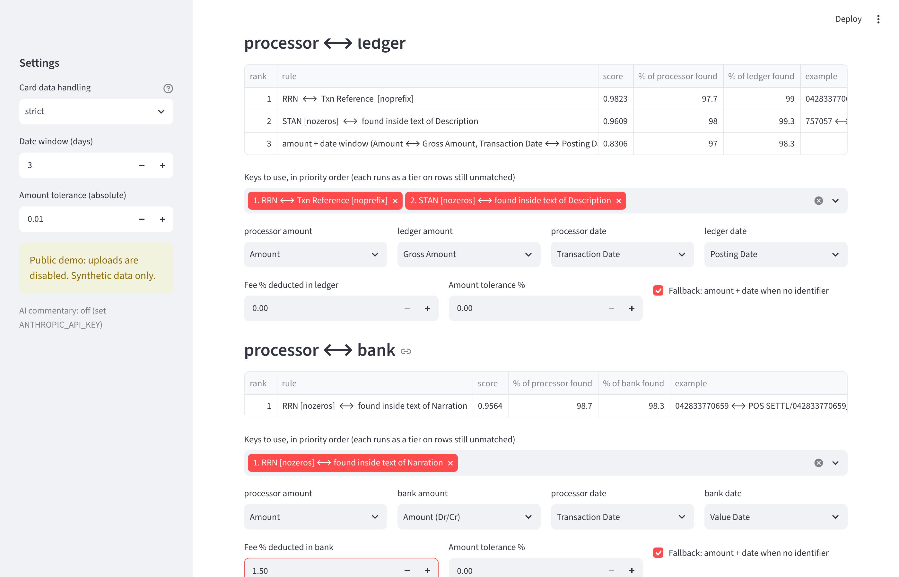

# anyrecon

**Reconcile any set of documents. You choose which documents pair; the engine finds the identifiers and runs the match.**

**▶ Try it now: [anyrecon.vercel.app](https://anyrecon.vercel.app)**. Runs in your browser; your files are never uploaded.



Drop in a processor export (CSV), a general ledger (Excel), a bank statement (PDF, even scanned), a settlement
report (JSON), as many as you need. For each pair you choose, anyrecon:

1. **Parses** the file whatever its shape: skips report preambles, finds the real header row, removes repeated
   PDF page headers and total / balance rows, combines Debit/Credit columns, OCRs scanned pages.
2. **Protects card data** before anything else touches it: masks PANs, drops CVV/PIN/track data. See [docs/PCI_DSS.md](docs/PCI_DSS.md).
3. **Discovers the identifier.** It measures every candidate column pair on the actual data, under transformations
   (case and punctuation, leading zeros, prefixes like `NX-`, last-N digits), finds references buried inside bank
   narrations, and falls back to amount + date window when no shared key exists. You see the ranked options with
   coverage percentages and examples, then confirm.
4. **Matches in tiers**: primary key → secondary key → one-to-many (batch settlements) → amount + date. Tolerances,
   expected fees (e.g. MDR), and date windows (T+1/T+2) are configurable.
5. **Explains the breaks**: missing, amount variance, timing, duplicate key, possible typo, OCR rows needing review.
   It also spots patterns, e.g. *"100% of variances sit at −1.50%: consistent with MDR"*.
6. **Chains 3+ documents**: processor ⟷ ledger ⟷ bank ⟷ settlement, one row per transaction showing where the chain breaks.
7. **Leaves an audit trail**: every match records the rule that made it; input file hashes, config and PCI actions
   go into the report and a JSON audit file. Same inputs + same template = same result.

> **Design rule:** AI may propose *how* to reconcile and explain the results. It never decides a match.
> Matching is deterministic code, so results are reproducible and auditable.

## Choose your edition

| | **Browser** | **Desktop** | **Server** |
|---|---|---|---|
| Best for | Anyone, including locked-down work laptops | Large files, scanned documents | IT teams serving a whole organisation |
| Install | None: [open the link](https://anyrecon.vercel.app) | Python, once | Docker |
| Your files | Stay in the browser tab | Stay on your computer | Stay on your company's server |
| Scanned documents | – | ✓ | ✓ |
| AI commentary | – | Optional | Optional |
| Start here | [editions/browser](editions/browser/README.md) | [editions/desktop](editions/desktop/README.md) | [editions/server](editions/server/README.md) |

All three run the same engine and give the same results.

## Quick start (developers)

```bash
git clone <this repo> && cd anyrecon
pip install -e ".[ui,ocr]"          # core needs only pandas, openpyxl, pdfplumber, rapidfuzz
python examples/generate_samples.py # synthetic, deliberately messy data in examples/data/

# web UI (local; files never leave your machine)
streamlit run app.py      # same as the Desktop edition launchers

# or the CLI
anyrecon inspect examples/data/processor.csv
anyrecon suggest examples/data/ledger.xlsx examples/data/bank_statement.pdf
anyrecon run -f processor=examples/data/processor.csv -f ledger=examples/data/ledger.xlsx \
             -f bank=examples/data/bank_statement.pdf -f settlement=examples/data/settlement_report.json \
             -p processor:ledger -p processor:bank -p processor:settlement \
             --fee processor:bank=1.5 --out report.xlsx --save-template my_recon.json
# next month, same files layout:
anyrecon run -f processor=nov.csv -f ledger=nov_gl.xlsx -f bank=nov.pdf -f settlement=nov.json --template my_recon.json
```

Add `-i` to confirm keys and columns interactively, and `--explain` for AI commentary (needs `pip install anthropic`
and `ANTHROPIC_API_KEY`).

### What the sample run finds

The generator plants known errors. The engine finds all of them without being told what to look for:

| Pair | Identifier found | Breaks found |
|---|---|---|
| processor ⟷ ledger | `RRN` = `Txn Reference` after stripping `NX-` and leading zeros; secondary: `STAN` inside the ledger description | 6 missing from ledger, 3 amount errors, 1 duplicate posting, 2 manual journals; the typo'd reference is still matched via the secondary key |
| processor ⟷ bank PDF | `RRN` found inside the narration `POS SETTL/042833770659/…` | detects the 1.5% MDR and T+1 lag; 4 missing settlements; bank charges isolated |
| processor ⟷ settlement JSON | `Settlement Batch` = `batch_id`, 30 transactions : 1 batch | short-settled batch flagged |
| bank ⟷ scanned image | narration (OCR) | low-confidence OCR rows held as `needs_review`, never auto-matched |

## Identifiers in unstructured narrations

Bank narrations follow no standard: `Trf frm ADA ref 0428 3377 0659`, `POS049980710157NGN`,
`being payment for inv 22 - 0712-3456-7890`. anyrecon doesn't try to parse the pattern. It looks for
identifiers it **already knows from the other document**: first as whole tokens (stripping prefixes and
leading zeros), then by scanning the text with separators removed, so spaces, hyphens, glued letters
and position don't matter. Keys under 8 characters are only matched as whole tokens to avoid chance hits.
Near-misses (a typo, or OCR reading 5 as S) are **suggested, never auto-matched**, and only when amount
and date also agree.

Not handled automatically: a reference that's truncated in the narration (only the last few digits),
or narrations that carry no reference at all. Those fall back to amount + date, or to aggregate matching.

## Parsing safeguards

| Problem | What anyrecon does |
|---|---|
| Long references turned into `4.28E+11` by Excel (digits lost) | **Red warning**: data is unrecoverable; re-export without opening in Excel |
| IDs stored as decimals (`42833770659.0`) | Trailing `.0` removed |
| Excel serial dates (`45931`) | Converted |
| Day/month ambiguity (`01/10/2026`) | Day-first assumed (Nigerian/UK convention) and flagged |
| Report titles above the header, total/balance rows, repeated PDF page headers | Removed and noted |
| Narrations wrapped onto a second PDF line | Joined back |
| Summary boxes mixed into a statement page | Flagged |
| Debit/Credit in separate columns | Combined with a direction column |
| `(1,200.00)`, `1,200.00 DR`, `1.234,56`, `₦ 3,000` | Parsed correctly |
| Mixed currencies in one column | Warning (FX not yet supported) |
| Refund and sale of the same value | Never paired by the amount + date fallback (signs must agree) |
| Password-protected or corrupt files | Clear message instead of a crash |
| Multi-sheet workbooks | Choose: largest sheet, a named sheet, stack same-layout sheets (monthly tabs), or each sheet as its own document. Hidden sheets ignored. CLI: `file.xlsx#Sheet`, `#*`, `#each` |

## Supported inputs

| Format | How | Notes |
|---|---|---|
| CSV / TSV / TXT | delimiter + encoding sniffing | preambles and total rows removed |
| Excel (xlsx/xlsm/xls) | picks the sheet with most data (or `sheet=`) | |
| JSON | finds the largest list of records, flattens nested fields | |
| PDF with text layer | table extraction (ruled, then whitespace) | multi-page headers de-duplicated |
| Scanned PDF / PNG / JPG / TIFF | Tesseract OCR, columns anchored to the header line | every row carries a confidence score; < 80% → review |

**On OCR:** a misread digit in a reference fails safe (the row shows as unmatched). A misread digit in an
**amount** can produce a false variance, or worse, a false match under tolerance. That's why OCR rows
are never auto-confirmed. If you have a choice, get the digital export.

## Architecture

```
ingest ─► PCI guard ─► profile ─► discover ─► (user confirms) ─► match (tiers) ─► chain ─► report + audit
 any format   mask/drop    types,     ranked key                    deterministic     N-way    Excel, JSON,
              before       semantic   candidates                    rules logged      trace    template
              anything     labels     with evidence
```

| Module | Role |
|---|---|
| `ingest.py` | loaders, header detection, cleanup, OCR |
| `pci.py` | PAN / SAD detection, masking, keyed tokens, block mode |
| `profile.py` | column typing, amount/date parsing (day-first aware), semantic labels |
| `discover.py` | identifier discovery: transforms, text extraction, composite keys, scoring |
| `match.py` | tiered matcher, 1:n / n:1 / n:m, fees, tolerances, exceptions, pattern insights |
| `chain.py` | auto-configuration, multi-pair runs, N-way chains |
| `report.py` | Excel report, JSON audit |
| `templates.py` | save/reuse setups (no data values stored) |
| `llm.py` | optional AI commentary and column labelling: summary stats only by default |

## Roadmap / good first contributions

- Amount-tolerant many-to-many (subset-sum within date windows) for partial settlements
- Learned column mappings from saved templates (auto-select template by file fingerprint)
- More statement layouts (multi-line narrations in PDFs)
- FX: reconcile across currencies with a rate table
- Connectors: pull directly from processor APIs / SFTP drops
- Local LLM option (Ollama) for column labelling with zero data egress

## Security

Read [docs/PCI_DSS.md](docs/PCI_DSS.md). anyrecon stores nothing: no database, no logs, no cache; uploads
live in memory for the session only. Short version: run it locally, never put a public instance online with uploads
enabled (`ANYRECON_DEMO=1` disables them), and never commit real data. The pre-commit hook blocks card numbers.

## License

MIT. See [LICENSE](LICENSE).
